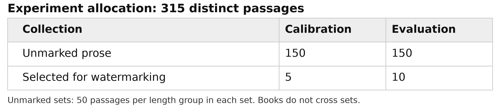
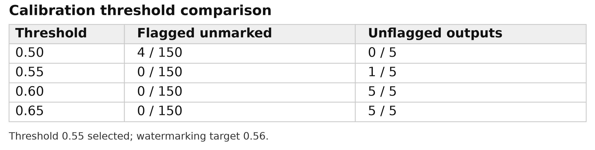
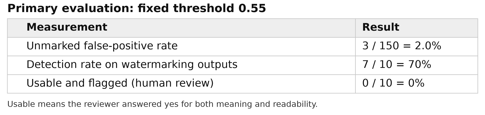
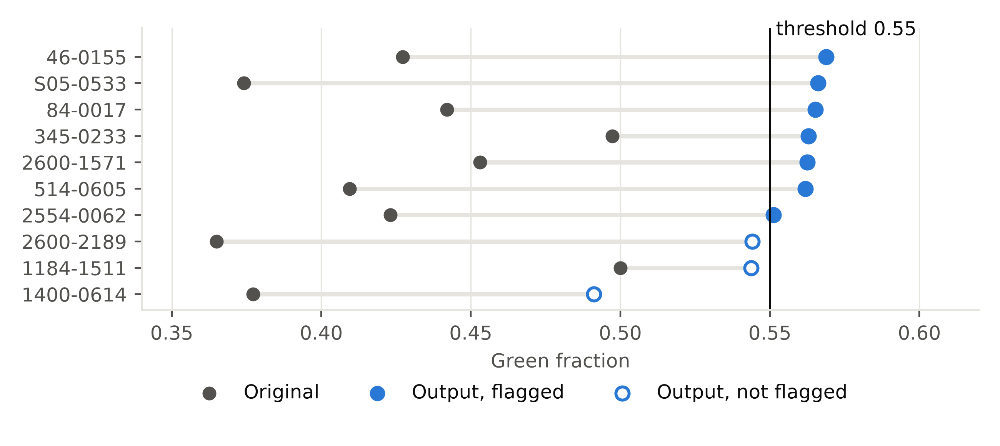
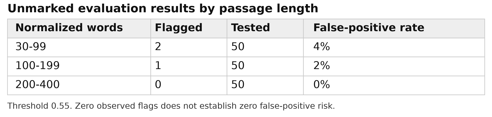
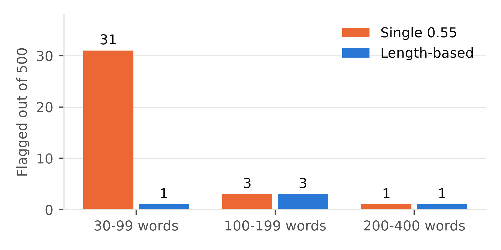
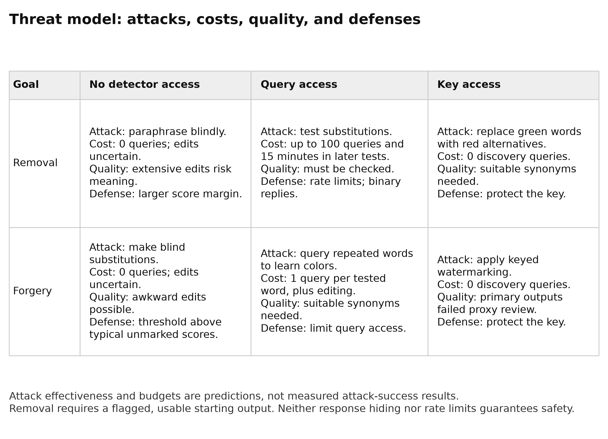

Milestone 1 Report
============

Rowen Ess, Austin Sternberg, Will Nahra

---

Introduction
------------

As artificial intelligence (AI) has come to dominate more and more of the technology-focused world, many issues have arisen with both dishonesty and honestly mistaking large language models (LLM)'s output for the creations of a human hand. This is an issue in many fields, for academics, for journalism, for literature, for the visual arts, for music, and for all areas of computer science. There are a few methods that have been devised to detect when some product is the spawn of machine rather than man, and of those, watermarking is the current preeminent method for the examination of bodies of text. 

In this report, we will endeavor to explain the implementation and results of a method of watermarking that "colors" words in such a way that if a threshold of those colored words is reached, the text is flagged. This is, of course, calibrated such that it will preferably give no false positives, though that is a difficult thing to guarantee.

Implementation 
------------

The basic function of the program is fairly simple, starting with generating a 32-byte long key. This key is then used to hash each word with HMAC-SHA256, and the last bit of the hash determines whether it is considered a "red" word (0) or a "green" word (1). The document is scored on number of green word occurrences divided by total word occurrences, so repeated words count each time they appear, and it is flagged only when the score is strictly greater than the threshold. A score equal to the threshold is not flagged.

One randomly generated key was used throughout, so a given word always has the same color. Watermarking and detection share the same word processing rules: text is put through Unicode NFKC normalization, curly apostrophes become straight ones, invisible format characters are removed, and words are casefolded. A word is a run of letters that may contain internal apostrophes, so `don't` is one word, while punctuation, digits, and hyphens separate words. Input containing no words is rejected with an explicit error.

Our first attempt at watermarking, with a list of only 10 synonyms, made no substitutions at all. Our final procedure uses a hand-built list of about 300 synonyms and short phrases, and accepts only edits that raise the score. Editing stops when the target of 0.56 is reached, when no permitted edits remain, or after 15 minutes, and the best output is kept even if it misses the target. These settings were frozen before the main evaluation, though they were fixed on detection counts alone, with no quality evidence.

This differs from the required reading in a few ways. Kirchenbauer et al. embed their watermark during generation, favoring green tokens as the model writes, with a hash of the previous token selecting which tokens are green. Our method works on text that already exists, where every edit must preserve someone else's meaning and grammar, and each word has one fixed color no matter its context. Their detector is also a statistical test whose evidence accumulates with length, whereas ours compares one fixed fraction for all text. As will be seen, that choice has a cost.

The data used for this program's calibration and evaluation were collected from Project Gutenberg. 46 books were collected, totalling 23,171 viable passages, though only 315 were used, drawn from 38 of those books:

*Table 1. Allocation of the 315 distinct passages. Each unmarked set contains 50 passages per length group.*

Whole books were assigned to one set or the other, so no book appears in both: 6 books supplied calibration and 32 supplied evaluation. Five of the 10 watermarking evaluation passages were selected at random, using a fixed seed, for later query-access forgery before any detector scores were seen. These come from *The Count of Monte Cristo*, *Great Expectations*, *Dracula*, *A Christmas Carol*, and *A Tale of Two Cities*.

For calibration, we ran the 150 calibration prose passages through the red/green program, and then filtered out the thresholds that would have given false positives:

*Table 2. Calibration counts for 150 unmarked passages and five watermarking outputs.*

We chose 0.55, which had no false positives in this test, and flagged 4/5 of the marked ones. This was considered sufficient for the purposes of this program, though zero false positives in 150 passages does not establish that the risk is negligible.

Evaluation
------------

The results of our evaluation step (with 150 unmarked and 10 marked) were as thus:

*Table 3. Primary evaluation at the frozen threshold of 0.55.*

Six of the 10 attempts reached the target, and the mean score rose from 0.427 before watermarking to 0.552 after. Of the four that ran out of edits, one (from *Crime and Punishment*, 0.551) was still flagged, and three were not: passages from *War and Peace* (0.544), *The Count of Monte Cristo* (0.544), and *Great Expectations* (0.491). Outputs changed between 6 and 29 words, counted by comparing the normalized word sequences, where each changed block counts as the larger of its two sides.

*Figure 1. Scores before and after watermarking for the 10 evaluation attempts. Hollow markers were not flagged.*

To quality check, a teammate who did not edit the passages reads 20 completely shuffled original and edited text pairs, the 10 word-swap outputs and the 10 sentence rewrites, stripped of all IDs, scores, system decisions, or target statuses. The reviewer then decides if the core meaning of the passage was preserved and if the resulting prose remained readable, and both answers must be yes for an output to be usable. A teammate's familiarity with how the scheme operates could make awkward wording seem more acceptable, so hiding the scores reduces bias but does not eliminate it.

**[PLACEHOLDER: human review results. Add the reviewer, usable counts out of 10 for word swaps and for rewriting, and example phrases that failed.]**

Our evaluation yielded an unmarked false-positive rate of 2.0%, with exactly 3 out of 150 natural human passages being incorrectly flagged as watermarked. These passages were never edited, so word substitution did not cause these flags. In these cases, natural text simply matched our static key's "green" criteria heavily enough to breach the 0.55 threshold. Because our detector only counts colors, it cannot distinguish between an intentional watermark and a human author who simply happens to write with a high density of green-hashed words. This shows that relying on post-generation token frequency metrics without evaluating semantic context or grammatical structure creates an unstable detection environment prone to false accusations.

Because the detector uses a fixed fraction rather than a length-dependent statistic, false-positive risk varies with document length. Among the 150 unmarked evaluation passages, the 30-99 word group had 2 false positives, the 100-199 group had 1, and the 200-400 group had none. Short passages have fewer words, so chance clusters of green words move their scores more, while longer passages stay closer to the average. Our larger tests below show the same pattern: at 0.55, false positives were about 5% for short passages and 0.2% for long ones, so long passages are not immune. The result is that short human-written text is the most likely to be wrongly flagged.

*Table 4. Flagged and tested unmarked passages by length. No flags in a group does not establish a zero false-positive rate.*

Repetition matters as well, since repeated words are not independent color assignments. The most repetitive evaluation passage, from *The Wealth of Nations*, has 289 words but only 109 distinct ones. Its score is 0.443 even though 52.3% of its distinct words are green, because common red words carry extra weight: `the` appears 24 times, `to` 17 times, and `in` 12 times. In the extreme case, `the` repeated 1,000 times scores 0 and `of` repeated 1,000 times scores 1, each representing a single color.

These numbers should be taken with some caution. Three flags in 150 gives an exact 95% interval of 0.4% to 5.7%, assuming independent, representative passages, and passages from the same book share vocabulary and style, so the real uncertainty is likely larger. Calibration showed this limit well: it flagged 0 of 150, yet all 1,933 candidate passages from the calibration books give 2.2% at 0.55. For an operator receiving an assumed 10,000 unmarked submissions a year, 2.0% would mean about 200 false flags, or 41 to 573 across the interval. As these are public-domain books, this should not be treated as an estimate for student work or modern writing.

After the main evaluation, we tested length-based thresholds: 0.68 for passages under 100 words and 0.56 for longer ones. These were chosen from the calibration books, but the evaluation result prompted the change, so they are reported separately. On 1,500 fresh unmarked passages, false positives fell from 2.33% to 0.33%. Detection dropped slightly, from 7 to 6 of 10.

*Figure 2. False positives among 1,500 fresh unmarked passages, with 500 per length group.*

We then replaced word swaps with sentence rewriting, restructuring whole sentences while checking each word's color with the key. On the same 10 passages, it flagged 9, compared with 7 before. These passages had been tested before, though, so this is not an independent result. **[PLACEHOLDER: usable rewrites out of 10, from the human review.]**

On 20 new passages, rewriting flagged 12, compared with 12 for word swaps at the 0.55 threshold and 9 at 0.56. It worked well on narrative, flagging 10 of 11, but poorly on expository text, flagging 2 of 9, though this grouping was made after seeing the results, so it is exploratory. Scoring 19,558 more unmarked passages confirmed the false-positive rates: 2.04% with one threshold and 0.28% with length-based thresholds.

Threat Model
------------

An attacker has one of two goals: removal, making a flagged and usable passage go unflagged, or forgery, making unmarked prose become flagged. Both must preserve meaning and readability. We consider three levels of access: none (knows the algorithm but has neither key nor detector), query (can submit text to the detector), and key (can compute colors locally). Nothing here has been run yet, so the attacks and costs below are predictions unless marked as measured.

*Table 5. Predicted attacks under no, query, and key access. Query limits are proposed budgets for Milestone 2.*

A few measured results shape these predictions. Flagged evaluation outputs sat only 0.001 to 0.019 above the threshold, so removal should take as few as 1 to 3 net green-to-red swaps, or roughly 5 to 20 queries with scores and more with binary responses. For query forgery, a word repeated many times scores 0 or 1, so one query reveals one color even when only the decision is shown, and the 100 most common red words already cover 40.7% of calibration tokens. Key forgery is simply our own procedure, which flagged 7 of 10 passages with 5 to 26 edits. **[PLACEHOLDER: whether these outputs passed the human review.]** Case changes and zero-width characters should have no effect, since our rules remove them, but NFKC does not fold Cyrillic lookalike letters, so those would give a word a new color.

**Key distribution.** The operator should retain the key and offer detection only as a service, since anyone able to detect locally with this key can also compute colors and forge. During detection the operator sees the submitted text, even if logs omit it. An independent reviewer could reproduce a disputed score by running the fixed program and key in a controlled environment, but this verifies the arithmetic, not authorship.

**Context dependence.** If a word's color depended on the words before it, learning a color from one repeated word would no longer apply everywhere, so query forgery would require far more probing and learned colors would be less reusable. Editing a word would also change its neighbor's color, which makes watermarking harder and removal easier. An attacker with the key could still compute any context locally.

**Digital signatures.** A digital signature shows that exact text was signed by the holder of a private key, and anyone can verify it without gaining the ability to sign. Changing one character invalidates it, and a compromised key can be revoked. A watermark instead gives a statistical signal that may survive some edits, but it has false positives, and here one shared secret both embeds and detects, so a leak allows forgery and casts doubt on earlier results. Neither establishes who actually wrote the text.

References
------------

- J. Kirchenbauer, J. Geiping, Y. Wen, J. Katz, I. Miers, and T. Goldstein. A Watermark for Large Language Models. ICML 2023. https://arxiv.org/abs/2301.10226
- Project Gutenberg (https://www.gutenberg.org), public-domain texts: Jane Austen, *Pride and Prejudice*; Mary Shelley, *Frankenstein*; Herman Melville, *Moby-Dick*; Lewis Carroll, *Alice’s Adventures in Wonderland*; Arthur Conan Doyle, *The Adventures of Sherlock Holmes*; Bram Stoker, *Dracula*; George Eliot, *Middlemarch*; Oscar Wilde, *The Picture of Dorian Gray*; Robert Louis Stevenson, *The Strange Case of Dr. Jekyll and Mr. Hyde*; Charlotte Brontë, *Jane Eyre*; Fyodor Dostoevsky, *Crime and Punishment*; F. Scott Fitzgerald, *The Great Gatsby*; Franz Kafka, *The Metamorphosis*; Alexandre Dumas, *The Count of Monte Cristo*; Charles Dickens, *Great Expectations*; Louisa May Alcott, *Little Women*; Mark Twain, *The Adventures of Tom Sawyer*; Leo Tolstoy, *War and Peace*; Emily Brontë, *Wuthering Heights*; Nathaniel Hawthorne, *The Scarlet Letter*; Charles Dickens, *A Christmas Carol*; Mark Twain, *Adventures of Huckleberry Finn*; H. G. Wells, *The Time Machine*; Robert Louis Stevenson, *Treasure Island*; L. M. Montgomery, *Anne of Green Gables*; L. Frank Baum, *The Wonderful Wizard of Oz*; Henry David Thoreau, *Walden*; Frederick Douglass, *Narrative of the Life of Frederick Douglass*; Jonathan Swift, *A Modest Proposal*; Charlotte Perkins Gilman, *The Yellow Wallpaper*; Charles Dickens, *A Tale of Two Cities*; Joseph Conrad, *Heart of Darkness*; H. G. Wells, *The War of the Worlds*; Booker T. Washington, *Up from Slavery: An Autobiography*; Charles Darwin, *The Voyage of the Beagle*; Charles Darwin, *On the Origin of Species*; Mark Twain, *Life on the Mississippi*; Adam Smith, *An Inquiry into the Nature and Causes of the Wealth of Nations*; John Stuart Mill, *On Liberty*; John Locke, *Second Treatise of Government*; Bertrand Russell, *The Problems of Philosophy*; Marcus Aurelius (tr. Meric Casaubon), *Meditations*; Ralph Waldo Emerson, *Essays: First Series*; Alexander Hamilton, John Jay, James Madison, *The Federalist Papers*; Thomas Paine, *Common Sense*; Niccolò Machiavelli (tr. W. K. Marriott), *The Prince*.
