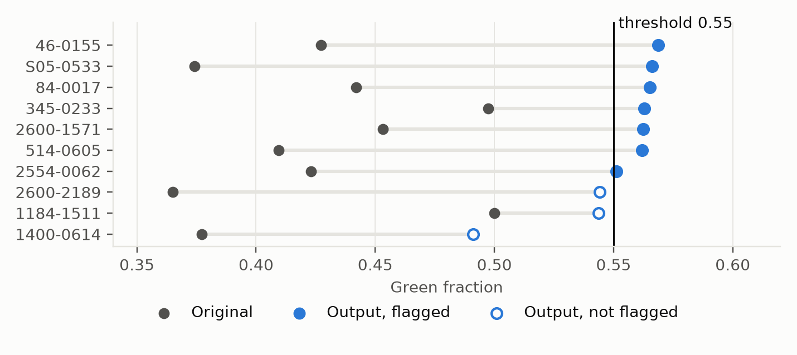

Milestone 1 Report
============

Rowan Ess, Austin Sternberg, Wil Nahra

---

Introduction
------------

As artificial intelligence (AI) has come to dominate more and more of the technology-focused world, many issues have arisen with both dishonesty and honestly mistaking large language models (LLM)'s output for the creations of a human hand. This is an issue in many fields, for academics, for journalism, for literature, for the visual arts, for music, and for all areas of computer science. There are a few methods that have been devised to detect when some product is the spawn of machine rather than man, and of those, watermarking is the current preeminent method for the examination of bodies of text. 

In this report, we will endeavor to explain the implementation and results of a method of watermarking that "colors" words in such a way that if a threshold of those colored words is reached, the text is flagged. This is, of course, calibrated such that it will preferably give no false positives, though that is a difficult thing to guarantee.

Implementation 
------------

The basic function of the program is fairly simple, starting with generating a 32-byte long key. This key is then used to hash each word, and the last bit of the hash determines whether it is considered a "red" word (0) or a "green" word (1). The document is scored on number of green words divided by number of reds, and is flagged when the score is greater than the threshold.

The data used for this program's calibration and evaluation were collected from Project Gutenberg. 46 books were collected, totalling 23,171 viable passages, though only 315 were used.

For calibration, we ran the 150 calibration prose passages through the red/green program, and then filtered out the thresholds that would have given false positives:

| Threshold | Flagged unmarked | Unflagged outputs |
| ---: | ---: | ---: |
| 0.50 | 4 of 150 | 0 of 5 |
| 0.55 | 0 of 150 | 1 of 5 |
| 0.60 | 0 of 150 | 5 of 5 |
| 0.65 | 0 of 150 | 5 of 5 |

We chose 0.55, which had no false positives in this test, and flagged 4/5 of the marked ones. 80% accuracy with negligible false positives was considered sufficient for the purposes of this program.

Evaluation
------------

The results of our evaluation step (with 150 unmarked and 10 marked) were as thus:

| Measurement | Result |
| --- | --- |
| Unmarked false-positive rate | 3 / 150 = 2.0% |
| Detection rate on watermarking outputs | 7 / 10 = 70% |
| Usable watermarking success rate | 0 / 10 = 0% |

To explain, the false positives being only 2% is good, considering 

To quality check, the reiewer reads 30 completely shuffled original and edited text pairs stripped of all IDs, scores, system decisions, or target statuses. The reviewer then decideds if the core meaning of the passage was preserved and if the resulting prose remained readable. The proxy review failed 100% of the watermarked text, determining that 0 out of 10 evaluation passages and 0 out of 5 calibration passages were usable. While a human teammate had been more lenient due to an familiarity with how the scheme operates.

Our evaluation yielded an unmarked false-positive rate of 2.0%, with exactly 3 out of 150 natural human passages being incorrectly flagged as watermarked. Looking closer, these false flags reveals that context-blind word substitution rules can easily backfire. In these cases, natural text accidentally matched our static key's "green" criteria heavily enough to breach the 0.55 threshold. Because our post-hoc algorithm relies on a rigid, hardcoded list of synonyms and context swaps, it cannot distinguish between an intentional machine watermark and a human author who simply happens to write with a high density of green-hashed words. This shows that relying on post-generation token frequency metrics without evaluating semantic context or grammatical structure creates an unstable detection environment prone to false accusations.

Because the detector uses a fixed fraction rather than a length-dependent statistic, false-positive risk varies with document length. Among the 150 unmarked evaluation passages, the 30–99 word group had 2 false positives, the 100–199 group had 1, and the 200–400 group had none. Short passages have fewer words, so chance clusters of green words move their scores more, while longer passages stay closer to the average. The larger tests in Sections 4.5 and 4.7 show the same pattern: at 0.55, false positives were about 5% for short passages and 0.2% for long ones, so long passages are not immune. The result is that short human-written text is the most likely to be wrongly flagged.

After the main evaluation, we tested length-based thresholds: 0.68 for passages under 100 words and 0.56 for longer ones. On 1,500 fresh unmarked passages, false positives fell from 2.33% to 0.33%. Detection dropped slightly, from 7 to 6 of 10, and the word-swap outputs were still unusable.

We then replaced word swaps with key-aware sentence rewriting. On the same 10 passages, it flagged 9 and produced 4 usable outputs, compared with none before. These passages had been tested before, though, so this is not an independent result.

On 20 new passages, rewriting produced 6 usable, flagged outputs, compared with 1 and 0 for the two word-swap versions (p ≈ 0.03 against v2). It worked well on narrative, flagging 10 of 11, but poorly on expository text, flagging 2 of 9. Scoring 19,558 more unmarked passages confirmed the false-positive rates: 2.04% with one threshold and 0.28% with length-based thresholds.

References
------------

- J. Kirchenbauer, J. Geiping, Y. Wen, J. Katz, I. Miers, and T. Goldstein. A Watermark for Large Language Models. ICML 2023. https://arxiv.org/abs/2301.10226
- Project Gutenberg texts, listed with URLs and licenses in `README.md` and `data/sources/sources.csv`.
