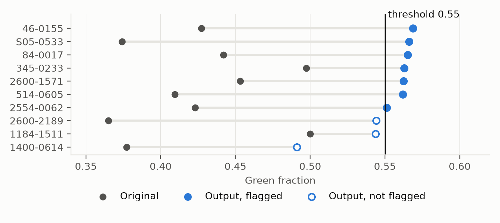
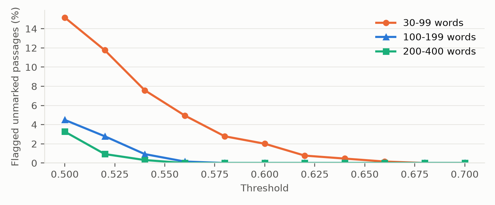
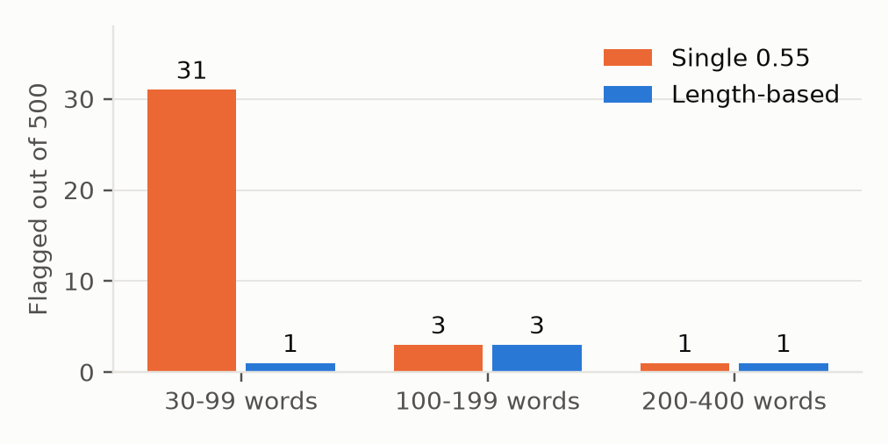

# Milestone 1: Detector, Evaluation, and Threat Model

**Draft status.** Items marked `[PENDING]` need the blind quality reviews. All other numbers come from saved runs in `results/`.

## 1. Scheme and detector

We generate one random 32-byte key with `secrets.token_bytes`. HMAC-SHA256 of a normalized word under that key gives its color: the last bit of the digest, with 1 meaning green and 0 meaning red. Every occurrence of a word has the same color. A document's score is green word occurrences divided by total word occurrences, and it is flagged when the score is strictly greater than the threshold. The comparison uses exact fractions, so a score equal to the threshold is never flagged through float rounding.

Watermarking and detection share one set of word rules. Text is NFKC normalized, curly apostrophes become `'`, and Unicode format characters (zero-width characters, soft hyphens, byte order marks) are removed. A word is a run of letters, optionally joined by internal apostrophes, so `don't` is one word and `well-known` is two. Digits and punctuation separate words. Words are casefolded. Input with no words raises an explicit error. We record total and distinct word counts for every passage.

Direct checks confirmed that 65 of 100 flags at 0.60, 60 of 100 does not, input with no words is rejected, `Book`, `book`, and `BOOK` are one distinct word, and a zero-width character inside a word has no effect.

**Comparison with Kirchenbauer et al.** Their watermark acts during generation. Before each token, a hash of the previous token seeds a partition of the vocabulary into green and red lists, and the sampler adds a bias to green logits, which favors green tokens mainly where several tokens are plausible. Our scheme acts after the text exists, and each word has one fixed color regardless of context. Theirs can draw on the model's many near-equivalent choices at every step, while ours is limited by which synonyms exist. The two also differ in detection. They use a z-test, whose statistic grows with the square root of the token count, so evidence accumulates with length. Our rule compares a fixed fraction, which treats short and long text alike. Section 4.5 shows the cost of that choice.

## 2. Data and split

We listed 46 Project Gutenberg books, combining two teammates' source lists and removing 14 duplicates. Script extraction produced 23,171 candidate passages, with repeated passages dropped. The experiment uses 315 distinct passages drawn from 38 of those books: 6 in calibration and 32 in evaluation.

| Collection | Calibration | Evaluation |
| --- | ---: | ---: |
| Unmarked (50 per length group) | 150 | 150 |
| Selected for watermarking (100-199 words) | 5 | 10 |

Whole books were assigned to one set with a seeded shuffle, before scoring, so no source appears in both. An earlier split had already been scored during a failed calibration run, so its two scored books (*The Adventures of Sherlock Holmes* and Douglass's *Narrative*) were pinned to calibration, and four more books were drawn at random to widen it. Calibration passages come from those six books, mostly *Huckleberry Finn* (61 of 150) and *Sherlock Holmes* (37). Only *The Prince* is not narrative prose, so calibration resembles evaluation less than we would like, since evaluation also includes economics, philosophy, and science writing.

The 5 query-access forgery passages (1184-1511, 1400-0614, 345-0233, 46-0155, S05-0533) were drawn from the 10 evaluation passages with `random.Random(2026)` after the split and before any scoring.

## 3. Calibration

**Failed first attempt.** The first run used a 10-entry synonym list, a threshold of 0.60, and a target of 0.70. It made 0 substitutions on all 5 passages. Analysis showed that a larger content-word list could not reach that target, because very common words such as `the`, `and`, `to`, and `a` are red under our key and have no safe synonym. That run is preserved in `results/calibration/run-20261030-202855`.

**Procedure.** The final procedure uses a hand-built list of about 300 entries, written from word frequencies in the calibration sources. Edits apply in list order: contractions that merge words (`could not` to `couldn't`), then synonyms, then swaps tied to a two-word context (`it was` to `this was`, `and said` to `then said`), and last the riskier `a` to `some` and `the` to `this`. Each edit must raise the score. The stopping rule is reaching the target, running out of edits, or 15 minutes per passage. The best output is kept even when it misses the target. In practice each passage took under 0.1 seconds.

**Threshold.** Counts from the final calibration run, with 150 unmarked passages and 5 outputs at target 0.56:

| Threshold | Flagged unmarked | Unflagged outputs |
| ---: | ---: | ---: |
| 0.50 | 4 of 150 | 0 of 5 |
| 0.55 | 0 of 150 | 1 of 5 |
| 0.60 | 0 of 150 | 5 of 5 |
| 0.65 | 0 of 150 | 5 of 5 |

We chose 0.55, which had no calibration false positives and flagged 4 of 5 outputs, with a target of 0.56. Three outputs reached the target. 76-0479, a dialect passage from *Huckleberry Finn*, stopped at 0.503 because few of its words have list entries. Outputs changed 9 to 24 words. Calibration quality results: `[PENDING: calibration review, 5 passages]`.

**Fixed settings.** Key in `secrets/watermark.key`, word rules from Section 1, threshold 0.55, target 0.56, and a 15-minute limit, frozen in commit 6964b34.

**Order of work.** Evaluation was run before the calibration quality review was complete, so these settings were fixed without that evidence. `[PENDING: state whether the review would have changed the procedure]`

## 4. Evaluation

### 4.1 Results

| Measurement | Result |
| --- | --- |
| Unmarked false-positive rate | 3 / 150 = 2.0% |
| Detection rate on watermarking outputs | 7 / 10 = 70% |
| Usable watermarking success rate | `[PENDING: evaluation review, 10 passages]` / 10 |

Six attempts reached the target, and passage scores rose from a mean of 0.427 to 0.552. Four stopped when edits ran out. One of those (2554-0062, 0.551) was still flagged. The other three were not: 2600-2189 (0.544), 1184-1511 (0.544), and 1400-0614 (0.491). Failures were not retried, under the fixed stopping rule. No original was flagged before watermarking.

*Figure 1. Scores before and after watermarking for the 10 evaluation passages at threshold 0.55. Hollow markers were not flagged.*

### 4.2 Quality check

A teammate who did not edit a passage compares original and edited versions and answers whether the main meaning is preserved and whether the prose is readable. Scores, decisions, and target status are hidden, and passages are shuffled. Changed words are counted from a diff of normalized word sequences, where each changed block counts as its larger side. Outputs changed 6 to 29 words. Results: `[PENDING: reviewer names, answers per passage]`.

We expect `the` to `this` swaps to read as mildly unnatural, and reviewers may rate them differently. A teammate knows how the scheme works and may recognize these patterns or accept awkward wording because they know the intended edit, so their ratings may be more lenient or more alert than a stranger's. Hiding scores limits this but does not remove it.

### 4.3 Length and repetition

| Length group | Flagged | Tested |
| --- | ---: | ---: |
| 30-99 | 2 | 50 |
| 100-199 | 1 | 50 |
| 200-400 | 0 | 50 |

Total and distinct counts for every passage are in `unmarked_scores.csv`. The most repetitive evaluation passage, S22-0282 from *The Wealth of Nations*, has 289 words but only 109 distinct words. Its score is 0.443 even though 52.3% of its distinct words are green, because common red words carry extra weight: `the` appears 24 times, `to` 17 times, and `in` 12 times. The top eight words make up 34.6% of the passage. This is why scores are not centered on 0.5. Across the calibration unmarked passages, 49.5% of distinct words are green but only 41.3% of word occurrences are. In the extreme case, `the` repeated 1,000 times scores 0 and `of` repeated 1,000 times scores 1, and each represents a single color assignment.

### 4.4 Uncertainty and annual false flags

With 3 flags in 150, the exact 95% interval for the false-positive rate is 0.4% to 5.7%. The `3/n` bound applies only when no errors occur. Calibration showed the same limit: 0 of 150 flagged, yet all 1,933 calibration-source passages give 2.2% at 0.55. That zero was a small-sample result, not evidence of a rate near zero. Passages from one book share vocabulary and style, so their results may be correlated. Evaluation passages come from 31 books, with 24 from *The Count of Monte Cristo* and 17 from *War and Peace*, so the effective sample is smaller than 150. Ten watermarking attempts allow only a rough estimate: 7 of 10 has an exact interval of 35% to 93%.

For an operator receiving 10,000 unmarked submissions a year, an assumed volume, 2.0% gives about 200 false flags, or 41 to 573 across the interval. These are public-domain books, mostly fiction, and they differ from student essays or modern writing, so this estimate should not be applied to such text without testing it.

### 4.5 Post-evaluation design change (separate run)

The results above are the primary evaluation and were not changed. Afterward, we looked for a way to lower false positives. The false-positive result in Section 4.1 prompted this work, so it is not independent of the evaluation.

The thresholds were chosen from the 1,933 calibration-source passages only. False positives at 0.55 were 5.9% for 30-99 words, 0.47% for 100-199, and 0.16% for 200-400, because scores vary more in short text (Figure 2). No single threshold worked: zero false positives there needed 0.68, while watermarked outputs reached only 0.50 to 0.64. We therefore set 0.68 under 100 words and 0.56 otherwise, with a target of 0.57. This has a similar effect to the length scaling in Kirchenbauer et al.'s z-test.

*Figure 2. Flagged share of 1,933 calibration-source passages at each threshold.*

We tested these settings on 1,500 fresh passages (500 per group), drawn at random from unused candidates in evaluation sources and not scored by any earlier run.

| Unmarked passages | Single 0.55 | Length-based |
| --- | ---: | ---: |
| 1,500 fresh passages | 35 (2.33%) | 5 (0.33%) |
| Original 150, repeated | 3 | 1 |

*Figure 3. False positives on 1,500 fresh passages by length group.*

The fresh-passage rate has an exact 95% interval of 0.11% to 0.78%, or about 33 false flags per 10,000 submissions (11 to 78). This is not zero. Calibration predicted about 1 in 1,933, and the fresh passages produced more, which shows how far a tuned estimate can drift on new text. The fresh passages are independent of this design, while the repeated 150 are not, because their results prompted it. The fresh passages also share books with the evaluation set and carry the same source correlation.

The cost was detection. On the same 10 watermarking passages, repeated and so not independent, 6 of 10 outputs were flagged instead of 7, with an exact interval of 26% to 88%. On the 5 calibration passages, 3 were flagged. 2554-0062 dropped out at 0.551. Quality for these outputs: `[PENDING: post-evaluation review]`.

## 5. Threat model

The attacker is assumed to know the algorithm, the word-processing rules, and the threshold. Costs below use the first evaluation settings (threshold 0.55, target 0.56). **Predicted** marks an expectation not yet tested. **Measured** marks a result from Section 3 or 4. Milestone 2 tests query-access removal, query-access forgery, and key-access forgery.

| Goal | None | Query | Key |
| --- | --- | --- | --- |
| Removal | **Attack:** reword blindly, or undo likely edits such as `this` back to `the`. Lookalike letters (Cyrillic `а` for Latin `a`) also give a word a new, random color. **Cost:** 0 queries, about 10 to 20 word edits. **Quality:** little harm, because reversing edits restores the source wording. **Defense:** a larger margin between target and threshold, and folding lookalike characters. **Predicted:** likely success, because flagged evaluation outputs sit 0.001 to 0.019 above the threshold and unmarked text averages 0.419 (measured). | **Attack:** swap words and keep changes that lower the score or clear the flag. **Cost:** about 1 to 3 net green-to-red swaps, so 5 to 20 queries with scores and more with binary responses. **Quality:** little harm, since few words change. **Defense:** binary responses and rate limits raise the cost but do not prevent success, because the attacker needs only one unflagged response. **Predicted:** likely success within 100 requests. | **Attack:** compute colors locally and replace green words with red synonyms. **Cost:** 0 queries needed, 1 to confirm, and 1 to 3 swaps calculated from the flagged evaluation outputs. **Quality:** little harm. **Defense:** none once the key is known, other than replacing the key. **Predicted:** near-certain success. |
| Forgery | **Attack:** apply lookalike characters to many words so that their colors are redrawn, or try synonym edits blindly. **Cost:** 0 queries, with no way to confirm the result. **Quality:** blind synonym edits harm readability, and lookalikes are invisible but machine-detectable. **Defense:** folding lookalike characters and rejecting mixed-script words. **Predicted:** low success. Blind edits move scores toward about 0.5, which is under the threshold, so most attempts should fail. | **Attack:** learn colors by submitting one word repeated, which scores 0 or 1, then edit as the watermarker does. **Cost:** 1 preparation query per word, with a 100-query budget, plus a few editing queries. The 100 most common red words cover 40.7% of calibration tokens (measured). **Quality:** similar to watermarking, and limited by which colors were learned. **Defense:** rate limits add time but not queries. Score hiding does not help, because the flag alone reveals each color. **Predicted:** success on some passages, fewer than with the key. | **Attack:** run the watermarking procedure directly. **Cost:** 0 queries, 5 to 26 edits per passage (measured). **Quality:** same as watermarking; blind review pending. **Defense:** none once the key is known, other than replacing the key. **Measured:** the keyed procedure flagged 7 of 10 evaluation passages at 0.55. |

Word-processing rules decide which character edits matter. Case changes and zero-width characters should have no effect (**predicted**), because words are casefolded and format characters are removed before tokenizing. Inserted hyphens or digits split a word into new words, so they can change the score but are visible to a reader. NFKC does not fold Cyrillic lookalikes to Latin letters, so those edits survive normalization.

### Key distribution

The operator should hold the key and run detection as a service. Anyone who can watermark locally or detect locally holds the same key, so they can also compute colors and forge. This scheme has no public detection key, and giving the key to a partner gives them the ability to forge. Watermarking should therefore be limited to the operator's own systems, and outside parties should submit queries.

During detection the operator sees the full submitted text, so a service design has to treat submissions as sensitive even when logs omit them. An independent reviewer can check a disputed result by re-running the fixed tokenizer, key, and threshold on the disputed text in a controlled setting, ideally under an escrow arrangement so that the reviewer never takes a copy of the key. That confirms the arithmetic of the score. It cannot establish who wrote the text.

### Context dependence

If a word's color depended on preceding tokens, one repeated-word query would no longer give a color that applies everywhere. The attacker would have to learn colors for word pairs or longer contexts, which needs many more queries and makes learned colors far less reusable across passages. Query-access forgery should become much harder within a 100-query budget.

The change would not stop every attack. Editing a word would also change the color of the word after it, so each edit has a wider effect on the score, which makes legitimate watermarking harder and makes removal easier: a few scattered edits disturb several colors at once. A query attacker can still probe specific phrases from the target passage directly. Key-access attacks are unaffected, because the attacker can compute any context locally.

### Digital signatures

A digital signature binds a document to the holder of a signing key at the time of signing. Verifying it shows that this exact text was signed by that key and has not changed since. It does not show who wrote the text, only who controlled the key.

The two approaches fail differently under editing. Changing a single character invalidates a signature, while a watermark is designed to survive some edits but degrades as a passage is rewritten. A signature can also be removed by discarding it, so a missing signature proves nothing. In the same way, an unflagged watermark result proves nothing about origin.

Key compromise is also different. Signature schemes separate private signing keys from public verification keys, so anyone can verify without being able to forge, and a compromised key can be revoked with later signatures rejected. This scheme uses one shared secret for embedding and detection, so a leak allows forgery and removal and casts doubt on every earlier result. Signatures therefore give stronger evidence for text that stays unchanged. A watermark can only give a statistical signal for text with no attached metadata, and that signal has the error rates reported in Section 4.

## References

- J. Kirchenbauer, J. Geiping, Y. Wen, J. Katz, I. Miers, and T. Goldstein. A Watermark for Large Language Models. ICML 2023. https://arxiv.org/abs/2301.10226
- Project Gutenberg texts, listed with URLs and licenses in `README.md` and `data/sources/sources.csv`.

## Contribution statement

See `README.md`. `[PENDING: confirm member names]`
